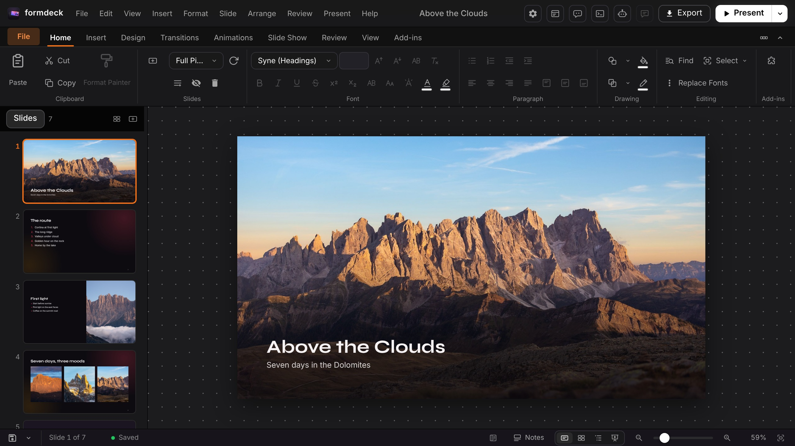
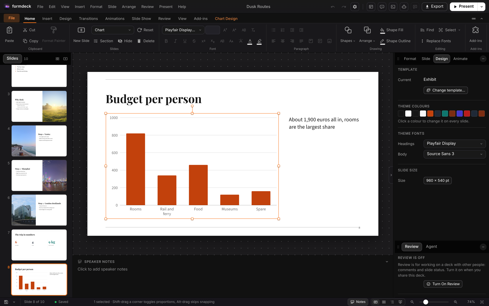
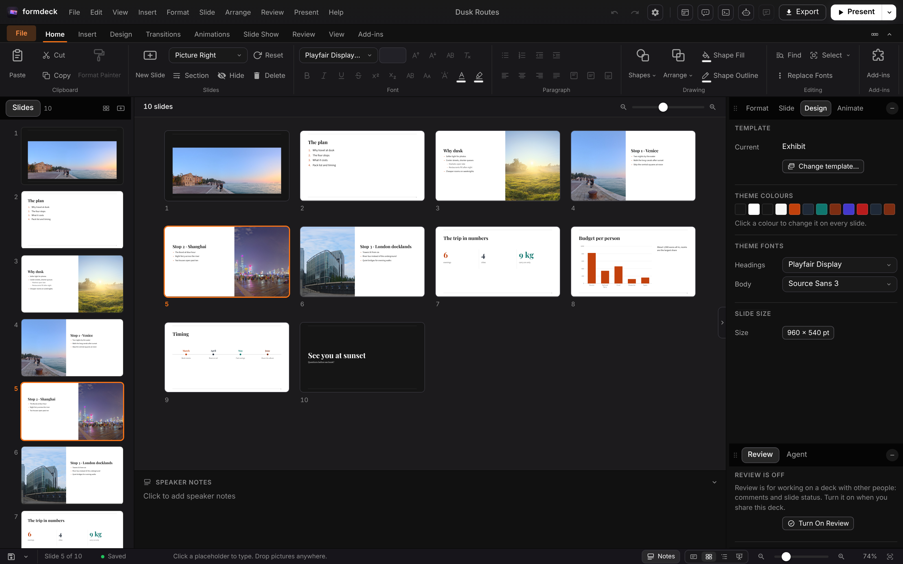
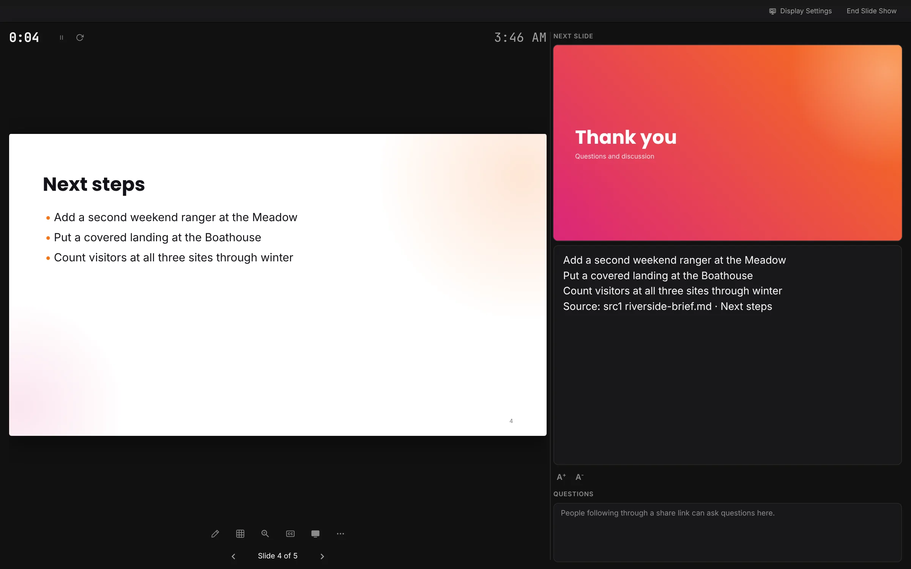
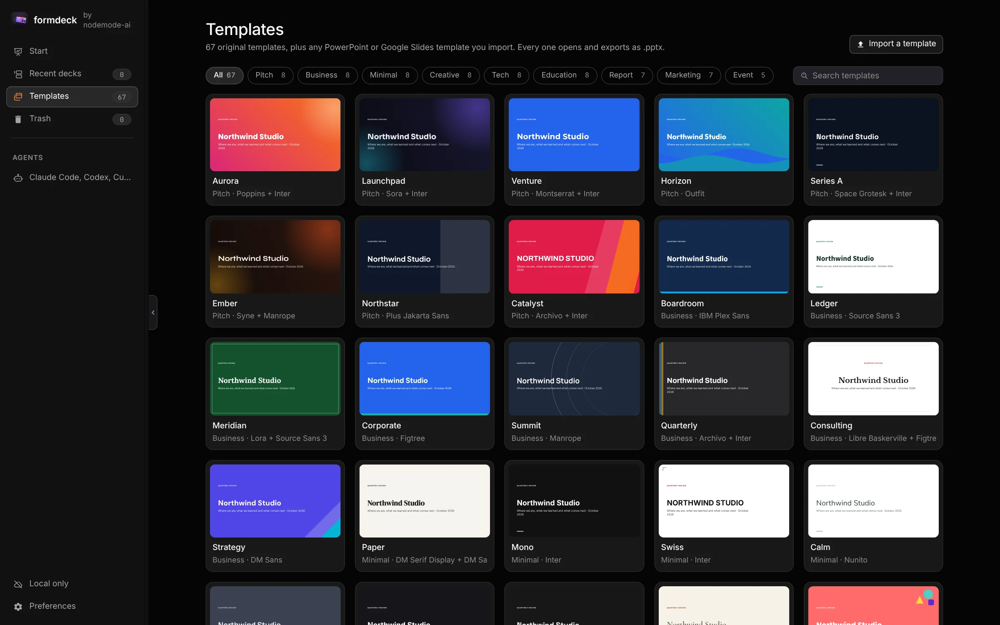

<p align="center"></p>

<h1 align="center">FormDeck</h1>

<p align="center">
  <b>Presentations; the deck editor of the Form family.</b><br>
  Templates, .pptx and .odp exchange, a presenter view and a Slide Master,<br>
  with an MCP server so an agent can draft a deck from your material. Local-first, no account.</p>

<p align="center">
  
  
  
  
  
  
</p>

<p align="center">
  <a href="https://formdeck.formai.studio/"><b>Download FormDeck on formai.studio</b></a> · <a href="#run-it-from-source">Run it from source</a>
</p>

<br>

<p align="center">
  
  <br><sub>A travel deck, Above the Clouds, open in the editor with the ribbon and the slide rail.</sub>
</p>

<p align="center">
  <a href="#features">Features</a> · <a href="#everything-in-the-box">In the box</a> · <a href="#built-for-agents">Agents</a> · <a href="#under-the-hood">Under the hood</a> · <a href="#download">Download</a> · <a href="#run-it-from-source">Run from source</a>
</p>

<br>

<table>
  <tr>
    <td width="25%" valign="top"><h3>Start from material</h3>Drop notes, PDFs, spreadsheets and pictures, pick a template, and get a drafted deck in seconds.</td>
    <td width="25%" valign="top"><h3>Works with PowerPoint</h3>Open and save .pptx and .potx, and exchange OpenDocument .odp, with a report of what changed.</td>
    <td width="25%" valign="top"><h3>Present anywhere</h3>Presenter view with notes and timer, twelve transitions, pen and laser, and live sharing on your network.</td>
    <td width="25%" valign="top"><h3>Agent-ready</h3>The same editor from the window, the command line and an MCP server with 31 tools.</td>
  </tr>
</table>

<br>

## Features

<table>
  <tr>
    <td width="50%" valign="top">
      
      <br><sub>A native chart, selected for editing.</sub>
      <h3>Charts, tables and shapes</h3>Charts, tables, all 187 Office shape presets and SVG are editable objects, not pictures.
    </td>
    <td width="50%" valign="top">
      
      <br><sub>The slide sorter beside the slide rail.</sub>
      <h3>Slide sorter and outline</h3>Reorder, hide and group slides into sections, in slide, sorter or outline view.
    </td>
  </tr>
  <tr>
    <td width="50%" valign="top">
      
      <br><sub>Presenter view with notes and audience questions.</sub>
      <h3>Presenter view</h3>A separate audience window, rehearsed timings, recorded narration and live subtitles.
    </td>
    <td width="50%" valign="top">
      
      <br><sub>The template picker.</sub>
      <h3>67 original templates</h3>Each has 21 semantic layouts. Import any .pptx as a template, or export every one as .pptx.
    </td>
  </tr>
</table>

## Everything in the box

<table>
  <tr>
    <td width="33%" valign="top"><h4>Editing</h4>Slide Master with several masters · Text Art · equations in LaTeX · merge shapes · freeform drawing · connectors · tables · charts · video and audio · motion paths</td>
    <td width="33%" valign="top"><h4>Presenting and review</h4>Zoom Slider · Speech Rehearsal · custom shows · kiosk mode · comments with replies · review status · version compare · Check Deck</td>
    <td width="33%" valign="top"><h4>Formats</h4>Opens: .fdec · .pptx · .potx · .ppsx · .pptm · .odp · Saves: .pptx · .odp · PDF · PNG · MP4 · WebM · GIF · Native: <code>.fdec</code></td>
  </tr>
</table>

Interface languages: English and 25 more, from Spanish and French to Japanese and Korean (Preferences > Appearance).

## Built for agents

31 MCP tools drive the same engine as the window: ingest, draft, build, render, lint and edit.

```sh
./formdeck agents install    # writes .mcp.json, .codex/config.toml and .cursor/mcp.json, installs the skills
./formdeck build-deck notes.md shots/ --template aurora --out update.pptx   # a deck without opening the window
./formdeck cli list          # the editor's command catalogue, run any command by id
./formdeck mcp               # MCP server on stdio for Claude Code, Codex and Cursor
```

`.mcp.json`, `.codex/config.toml` and `.cursor/mcp.json` are already wired in this repo. See [`AGENTS.md`](AGENTS.md).

## Under the hood

- **Engine:** a FastAPI service holds every deck; each change is a JSON op with an inverse, broadcast to every window and agent.
- **Window:** vanilla TypeScript and Vite, with an inline-SVG icon set and no UI framework.
- **Desktop:** a Tauri 2 shell around the same window, with the engine frozen as a sidecar.
- **Format:** `.fdec` is a package around `deck.json`, documented in [`docs/FORMAT.md`](docs/FORMAT.md).
- **Tested:** pytest suites in `backend/tests` and a browser window test in `frontend/tests`.

## Download

| Platform | Download | Release |
|---|---|---|
| macOS | [Download FormDeck for macOS](https://formai.studio/get/formdeck/macos) | [FormDeck releases on FormCompiler](https://github.com/nodemode-dev/formcompiler/releases?q=formdeck-v&expanded=true) |
| Windows | [Download FormDeck for Windows](https://formai.studio/get/formdeck/windows) | [FormDeck releases on FormCompiler](https://github.com/nodemode-dev/formcompiler/releases?q=formdeck-v&expanded=true) |
| Linux | [Download FormDeck for Linux](https://formai.studio/get/formdeck/linux) | [FormDeck releases on FormCompiler](https://github.com/nodemode-dev/formcompiler/releases?q=formdeck-v&expanded=true) |

All FormDeck builds are compiled and released from [FormCompiler](https://github.com/nodemode-dev/formcompiler); this repo holds the source.

## Run it from source

Prefer it in your browser, or want to contribute? Run the web UI straight from this repo.

**Requires:** Python 3.12+ and Node 20.19+.

```sh
git clone git@github.com:nodemode-dev/formdeck.git
cd formdeck
./formdeck install   # backend venv and frontend packages
./formdeck           # web UI at http://localhost:5197
```

**Demo:** open [`demo/index.html`](demo/README.md) in a browser, with no install and no network. It runs the real slide renderer on a sample deck or on your own .pptx, .fdec or deck.json, with slide ops, Check Deck and PNG, PDF and .fdec export.

`./formdeck desktop dev` opens the desktop window instead. On Windows use `formdeck.bat install` and `formdeck.bat`. The engine listens on `127.0.0.1:8197` (MCP at `/mcp`); `FORMDECK_DATA_DIR` moves the data folder from `~/formdeck`.

> [!IMPORTANT]
> **Status:** active development. Sharing beyond your network needs a relay you run yourself, the 25 translations are machine made and not yet reviewed, and a phone or tablet cannot reach the engine yet. See [`docs/PARITY.md`](docs/PARITY.md).

**Contributing:** branch from `main`, keep changes to source here, and leave packaging and releases to FormCompiler. See [`CONTRIBUTING.md`](CONTRIBUTING.md), [`CODE_OF_CONDUCT.md`](CODE_OF_CONDUCT.md), [`.docs/BRANCHING.md`](.docs/BRANCHING.md) and [`AGENTS.md`](AGENTS.md). Report security issues privately as [`SECURITY.md`](SECURITY.md) describes.

## Repository

| Path | What it is |
|---|---|
| `backend/` | FastAPI engine: deck store, ops, compiler, intake, templates, pptx, MCP |
| `frontend/` | Vanilla TypeScript and Vite window: render, editor, present, ui |
| `setup/` | Install, boot, build, freeze and agent setup scripts |
| `src-tauri/` | Desktop shell and the engine sidecar |
| `docs/` | FORMAT.md, MANUAL.md, ADDINS.md, PARITY.md |

Docs: [`.docs/wiki`](.docs/wiki) · Agents: [`CLAUDE.md`](CLAUDE.md), [`AGENTS.md`](AGENTS.md) · Contributing: [`.docs/BRANCHING.md`](.docs/BRANCHING.md)

<br>

---

## Maintainers

| Maintainer | Role |
|---|---|
| [@nodemode-ai](https://github.com/nodemode-ai) | Owner |
| [@gbarnai](https://github.com/gbarnai) | Co-owner |

Code owners are set in [`.github/CODEOWNERS`](.github/CODEOWNERS).

## License

FormDeck is licensed under the Apache License 2.0 ([`LICENSE`](LICENSE), SPDX `Apache-2.0`). Copyright 2026 NodeAgentc, Inc. Third-party notices: [`NOTICE.md`](NOTICE.md).

<sub>Microsoft and PowerPoint are trademarks of the Microsoft group of companies; Keynote is a trademark of Apple Inc.; Google Slides is a trademark of Google LLC. FormDeck is an independent project and is not affiliated with or endorsed by them.</sub>

<sub>Screenshot content: CC0 photos from Poly Haven; the deck text is original.</sub>
